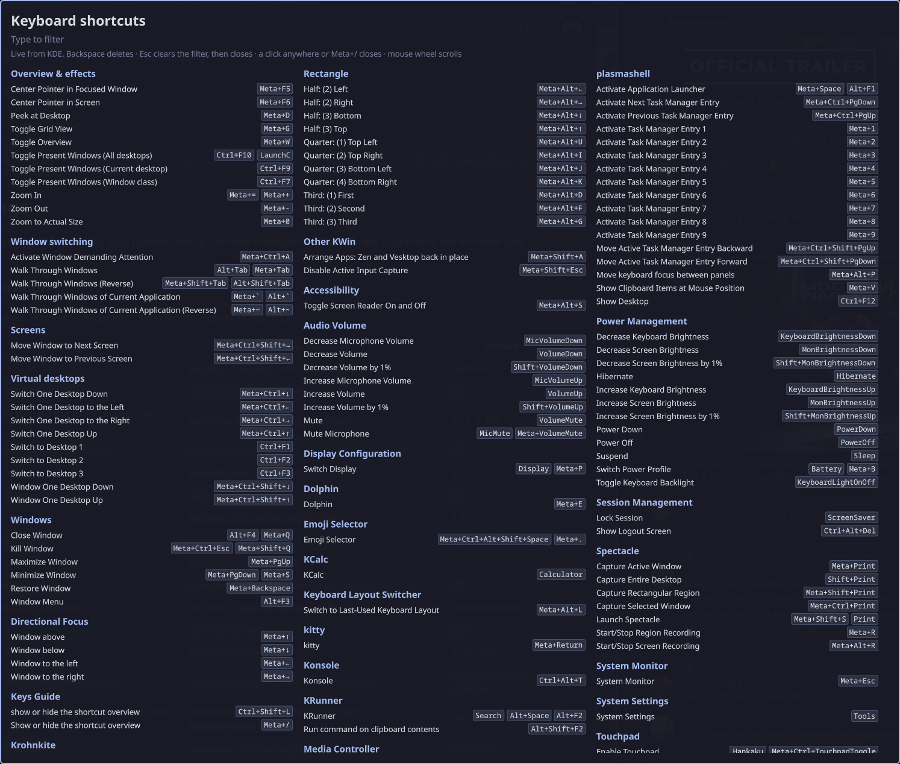

# Keys Guide

A KWin script for KDE Plasma 6 that shows every global shortcut you have, with
the key it has **right now**, in one overlay. Press <kbd>Meta</kbd>+<kbd>/</kbd>
to open it, and type to filter it. Press <kbd>Esc</kbd> to clear the filter
and again to close, or click anywhere, or press the shortcut again.



- **Live.** It asks kglobalaccel (KDE's global shortcut service) over D-Bus
  each time it opens. A key you change in System Settings shows up straight
  away, and so do the shortcuts of any KWin script, app or Plasma part.
- **Only bound shortcuts.** Actions without a key aren't shown.
- **Type to filter.** Letters, digits and spaces narrow the list. Every word
  you type has to appear in the shortcut's name, its keys or its section, so
  `meta shift` shows everything on Meta+Shift. <kbd>Backspace</kbd> deletes.
- **Grouped.** KWin's own actions are split into *Overview & effects*,
  *Window switching*, *Screens*, *Virtual desktops*, *Windows* and *Other
  KWin*. Each KWin script whose shortcuts are labelled `Script name: …` gets
  its own section. Every other component (Plasma, Spectacle, KRunner, media
  keys and so on) gets a section under its own name.
- **Your colours.** It uses your colour scheme. You can set an accent colour.
- **Your sections.** You can add custom sections and hide shortcuts with
  regular expressions (see [Settings](#settings)).

Tested on Plasma 6.8, Wayland. It needs Plasma 6.0 or newer.

## Install

From a release file (or one you built, see [Build](#build)):

```sh
kpackagetool6 --type=KWin/Script -i keys-guide-1.0.0.kwinscript
```

Then enable **Keys Guide** under System Settings › Window Management › KWin
Scripts. To update, use `-u` instead of `-i`. To remove it, run
`kpackagetool6 --type=KWin/Script -r keysguide`.

After an update, turn the script off and on again (or log out and back in).
KWin keeps the old version loaded until then.

## Changing the key

The key is an ordinary global shortcut. Go to System Settings › Keyboard ›
Shortcuts › KWin and find **Keys Guide: Show or hide the shortcut overview**.

<kbd>Meta</kbd>+<kbd>/</kbd> wasn't bound to anything else on the test system, and doesn't
take a key from apps. On layouts where `/` needs <kbd>Shift</kbd> (German,
Nordic and others), the default may not trigger. Rebind it there.

While the guide is open, it also holds 39 keys as temporary global shortcuts:
<kbd>a</kbd>–<kbd>z</kbd>, <kbd>0</kbd>–<kbd>9</kbd>, <kbd>Space</kbd>,
<kbd>Backspace</kbd> and <kbd>Esc</kbd> (see [Gotchas](#gotchas) for why).
It removes them all from kglobalaccel when it closes, so the keys go back to
your apps. If you see **Keys Guide: Type into the filter**, **Delete a filter
letter** or **Clear the filter, or close** in System Settings while the guide
is closed, they're leftovers and safe to remove.

## Settings

System Settings › Window Management › KWin Scripts › Keys Guide › configure:

| Setting | What it does |
| --- | --- |
| Custom sections | One `Title: regex` per line. A shortcut whose label or action id matches the regex (case-insensitive) goes in that section. Custom sections come first, in the order you write them. Lines starting with `#` are ignored. Lines that don't parse are listed at the top of the guide. |
| Hide shortcuts matching | One regex. Hides any shortcut whose label, action id or `Component: label` matches, for example `^Plasma: \|Volume`. |
| Give each KWin script's shortcuts their own section | On by default. Turn it off to sort script shortcuts into KWin's groups instead. |
| Custom accent colour | Replaces the colour scheme's highlight colour for section titles, the border and key chips. |

Example custom sections:

```
Focus: ^Switch Window|Focus
Screenshots: Spectacle|screenshot|Print
```

Action ids are the same in every language, labels aren't. For portable
patterns, match the action id (for example `^Walk Through`). You can find
action ids in `~/.config/kglobalshortcutsrc`.

## Gotchas

- **Typing works through global shortcuts.** KWin never gives keyboard focus
  to a script's own windows, so key presses can't reach the guide. Instead,
  the keys it needs are global shortcuts while it's open (see above). Only
  plain letters, digits and space can be typed, and arrow keys don't scroll:
  use the mouse wheel. While the guide is open, those keys don't reach your
  apps. If another global shortcut already uses one of them as a bare key,
  that letter won't type.
- **Covers the whole monitor.** The overlay is an unmanaged window covering
  the active monitor, panels included. That's how a click anywhere can close
  it.
- **Border effects.** The overlay's window title is `Keys Guide overlay`. If a
  border or rounded-corner effect draws an outline around it, exclude that
  title in the effect's settings. With KDE Rounded Corners
  (`kwin-effect-rounded-corners`) on Plasma 6.8, no outline was drawn, even
  without an exclusion.
- **Scripts that are turned off.** kglobalaccel keeps the keys of KWin
  scripts that are turned off. If such a script still has keys bound, they
  show up. Hide them with *Hide shortcuts matching*, or clear their keys in
  System Settings.
- **Editing settings by hand.** KWin caches `kwinrc`. If you edit
  `[Script-keysguide]` by hand, run `qdbus6 org.kde.KWin /KWin reconfigure`.
  System Settings does this for you.

## How it differs from what's there

As of October 2026, no KWin script or Plasma widget on the KDE Store or
GitHub shows your live global shortcuts as an overlay.

- **System Settings › Shortcuts** has the same data and lets you edit it. But
  it shows one component at a time and is a full settings window.
- **Static cheat sheets** (KDE docs, websites) list the defaults, not your
  keys.
- **Tiling scripts' own help overlays** show only that script's keys.

Keys Guide is read-only and shows everything at once. It opens in a key press.

## Build

```sh
./build.sh
```

This runs the tests (`node tools/test-grouping.mjs`) and writes
`dist/keys-guide-<version>.kwinscript`. The file is a zip of `package/`, the
format the KDE Store and `kpackagetool6` take. It needs `node` and `python3`.

`package/contents/ui/KeyNames.js` maps Qt key codes to names. It's generated
from Qt's headers. If a new Qt version adds keys, regenerate it:

```sh
tools/gen-keynames.py /usr/include/qt6/QtCore/qnamespace.h > package/contents/ui/KeyNames.js
```

## Developing

`ui/main.qml` is only a `Loader` for `ui/Guide.qml`. KWin caches the main
file of a script, and what that file imports, until you log out. Loading
`Guide.qml` under a new URL each time means an edit takes effect when the
script is turned off and on again.

Qt also caches each folder's file list. A file *added* to an installed
script's folder reports "File name case mismatch" until you log out. To test
changes without logging out, load a copy from a fresh folder each time:

```sh
set dir (mktemp -d)
cp -r package/* $dir/
set id (qdbus6 org.kde.KWin /Scripting org.kde.kwin.Scripting.loadDeclarativeScript $dir/contents/ui/main.qml keysguide-dev)
qdbus6 org.kde.KWin /Scripting/Script$id org.kde.kwin.Script.run
qdbus6 org.kde.kglobalaccel /component/kwin org.kde.kglobalaccel.Component.invokeShortcut KeysGuideShow
qdbus6 org.kde.KWin /Scripting org.kde.kwin.Scripting.unloadScript keysguide-dev
```

(These are fish commands. In bash, use `dir=$(mktemp -d)` and so on.) Settings
for a script loaded this way are read from `[Script-<name>]` in `kwinrc`,
where `<name>` is the second argument above. Errors go to the journal:
`journalctl --user -f`.

To take a screenshot of the overlay, use a full-screen capture
(`spectacle -b -n -f -o shot.png`) and crop it. The overlay never becomes the
active window, so `-a` won't catch it.

## License

MIT, see [LICENSE](LICENSE).
